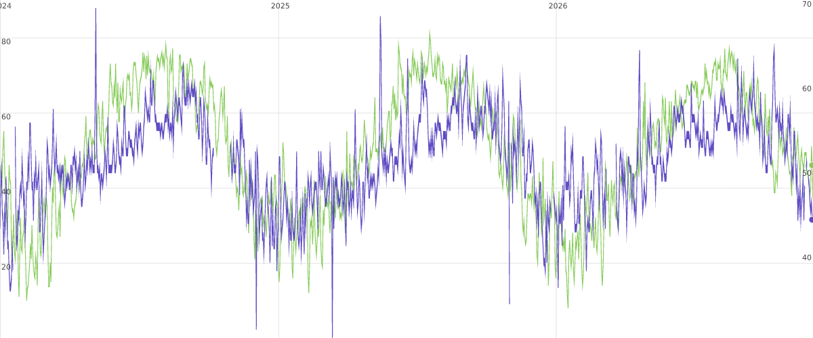

# Proposal: transitioning `svg-time-series` to an idiomatic D3 library

**Status:** draft for review · **Scope:** public API, internals that the API leaks, packaging, tests, docs
**Non-goal:** changing the rendering strategy — the rasterizer-side transform pipeline is the reason
this library exists and is not up for negotiation in this proposal.

---

## TL;DR

The engine is excellent and unusual: it reaches 60 FPS by keeping coordinate math out of JavaScript
(`scaleToDomMatrix`, `ViewportTransform`, RMQ autoscaling, `requestAnimationFrame` batching). The
_public interface_ around it, however, is a class with six positional constructor arguments, a
C-style data source with two numeric indices, a required "legend controller" interface, and a
hand-rolled axis that is a fork of `d3-axis` — so consumers cannot use it the way D3 users expect to
use a chart, and every sample in the repository ends up reaching into the library's internals or
patching its instances.

This proposal separates the two concerns:

1. **Interface idiomatic, internals still fast.** A reusable closure component
   (`timeSeriesChart().x(...).series(...).on(...)`), called as `selection.datum(data).call(chart)`,
   with accessors, D3-dispatch events and data-bound DOM. Internally it still renders through
   `transform="matrix(...)"` and O(log N) range queries.
2. **A thin facade first, internal surgery second.** Phase 1 (already implemented on this branch,
   purely additive) wraps the existing class. Phases 2–6 remove the reasons the facade has to be
   clever: in-place updates, margins, `d3-axis` interop, ring-buffer streaming, `exports`-based
   packaging.

Nothing in the current public API has to break before v1.0; the class stays as a deprecated
`legacy` export for one minor release.

| Phase | Deliverable                       | Breaking | Status on this branch |
| ----- | --------------------------------- | -------- | --------------------- |
| 0     | Packaging, naming and metadata    | no       | proposed              |
| 1     | Idiomatic facade + tests + demo   | no       | **implemented**       |
| 2     | In-place updates, margins, resize | no       | proposed              |
| 3     | `d3-axis` interop                 | no       | proposed              |
| 4     | Events and interaction surface    | no       | proposed              |
| 5     | Streaming and columnar data       | no       | proposed              |
| 6     | Stock legend, docs, v1.0 cleanup  | yes (v1) | proposed              |

---

## 1. What "idiomatic D3" means here

The conventions D3 users expect, taken from the D3 documentation and the reusable-charts pattern:

| Convention                                     | Canonical form                                                                           |
| ---------------------------------------------- | ---------------------------------------------------------------------------------------- |
| A chart is a **function of a selection**       | `selection.datum(data).call(chart)` — `d3-axis`, `d3-brush`, `d3-zoom` all work this way |
| Configuration is a **chainable getter/setter** | `chart.width()` / `chart.width(640)`; same method, `arguments.length` dispatch           |
| Data enters through **bound data + accessors** | `datum`, `.data()`, `x(d, i)`, `y(d, i)`, `key(d)`                                       |
| DOM is produced by a **data join**             | `selection.data(values, key).join(enter, update, exit)`                                  |
| The DOM **carries the data back**              | `selection.data()` / `.datum()` return the user's objects, not internal records          |
| **Scales are first-class user objects**        | `scaleTime()`, `scaleLinear()`, `transform.rescaleX(scale)`; the user owns them          |
| **Axes come from `d3-axis`**                   | `axisBottom(scale)` composed into the chart, overridable by the caller                   |
| Events use **`d3-dispatch` semantics**         | `chart.on("zoom.foo", handler)`, `off("zoom.foo")`, handler `(event, d)`                 |
| Behaviours are **injectable**                  | `chart.zoom(zoomBehavior)`, `chart.brush(brushBehavior)` — not hidden inside             |
| A library is **tree-shakeable ESM with types** | `exports` map, `sideEffects: false`, `d3` as a peer dependency                           |
| Tests **assert the rendered DOM**              | `expect(svg.node().outerHTML).toBe(golden)` rather than internal state                   |

Two of these deserve emphasis because they are the ones most often mistaken for "just style":

- **The DOM is the API.** A D3 consumer assumes that after `chart(selection)`, the produced nodes
  are selectable, styleable and data-bound: `svg.selectAll("g.view > path").attr("stroke", d => d.stroke)`
  must work. Today the paths carry no datum at all, and the sample CSS has to use
  `g.view:nth-child(1) > path` (`samples/demos/index.css:26`) because series have no identity in the DOM.
- **The user owns the interaction behaviours.** Today `ZoomState` builds its own `d3-zoom` behaviour,
  keeps it private, and `draw.ts:356` reaches into it with a cast to re-register the `zoom` handler.
  In idiomatic D3 the behaviour is an accessor: `chart.zoom().filter(...)`, `chart.zoom(zoom)`.

### 1.1 Idiomatic interface ≠ idiomatic internals

The performance tricks are compatible with all of the above, and they must be preserved:

- rasterizer-side matrix transforms (`src/utils/domMatrix.ts`) instead of per-point JS loops;
- `ViewportTransform` + `transform="matrix(a,b,c,d,e,f)"` (`src/utils/domNodeTransform.ts`);
- O(log N) autoscale through `segment-tree-rmq` (`src/chart/axisData.ts:31`);
- one render per frame via `drawProc` / `ZoomScheduler` (`src/utils/drawProc.ts`,
  `src/chart/zoomScheduler.ts`);
- "don't touch attributes that did not change" (`src/chart/render.ts:94`, `seriesRenderer.ts:14`).

What must change is only how much of this the _consumer_ has to know. The facade in Phase 1 is the
proof: it produces exactly the same DOM and the same number of DOM writes as the class API, because
it _is_ the class API underneath.

---

## 2. Gap analysis

Sixteen findings, ordered by how much they hurt consumers. Each one names the target state; phases
in §6 group the work.

### A. Entry point and API shape

**A1. Constructor instead of a reusable closure** (`src/draw.ts:90`)
`new TimeSeriesChart(svgSelection, dataSource, legendController, zoomHandler, mouseMoveHandler, zoomOptions)`
— six positional arguments, three of them callbacks or interfaces the user must implement before
they can see a chart. Not callable with `.call()`, not re-entrant, and every configuration change
requires touching `chart.interaction.*`.

> **Target:** `timeSeriesChart<Datum>().x(...).series(...).on(...)`, called via
> `selection.datum(data).call(chart)`; the class becomes an implementation detail.

**A2. No chainable configuration** — behaviour is configured by mutating a sub-object after
construction (`chart.interaction.setScaleExtent([1, 80])`, `chart.interaction.enableBrush()`), which
means the chart cannot be configured before it has a selection, and cannot be configured twice.

> **Target:** one method per option with getter/setter overloads; setters return `this`.

### B. Data model

**B1. Values, not data** (`src/chart/data.ts:15`)
`IDataSource.getSeries(i, seriesIdx)` forces callers to flatten their rows into a random-access
`number[][]` keyed by two integer indices. The user's objects never reach the chart, so no event,
attribute or legend can refer to them.

> **Target:** an array of user datums plus `x`/`y` accessors; `getSeries` survives only as an
> internal adapter (and as the streaming path, see B3).

**B2. Eager full materialisation** (`src/chart/data.ts:77`) — the constructor copies the entire data
set (`rows × series` numbers) even though the engine only ever needs a window of it. Idiomatic D3
reads data through accessors, lazily.

> **Target:** store accessors; materialise columns once per series (columnar, feature-detectable
> `Float64Array`), and invalidate only the RMQ index on append.

**B3. Uniform sampling is implicit, and index arithmetic leaks** (`src/chart/dataWindow.ts`)
The engine draws with index coordinates, so the data has to be evenly spaced; nothing validates
this, and nothing in the interface says it. Meanwhile `LegendPoint.timestamp`
(`src/chart/legend.ts:9`) is computed from the window, so a _window-relative_ index
(`src/chart/slidingWindow.ts:46`, `startIndex`) is handed out with no way back to the caller's row.

> **Target:** validate uniformity in the facade with an actionable error (implemented in Phase 1),
> expose `chart.timeStep()`/`chart.startTime()` for consumers writing their own overlays, and keep
> irregular sampling on the roadmap (bisector + `scaleTime` path).

### C. DOM and joining

**C1. Internal records are bound to the DOM** (`src/chart/series.ts:42`)
`g.view` nodes are bound to `{id, axisIdx, seriesIdx}` records. They are not the user's data, and the
`path` children have no datum at all, so `selectAll("g.view > path").data()` is `undefined` and
attribute functions cannot see anything.

> **Target:** bind the `SeriesSpec`/datum to the produced nodes and keep it stable across updates so
> that `.attr("stroke", d => d.stroke)` and `.attr("data-series", d => d.key)` work in _user_ code.

**C2. The join is decorative** (`src/chart/series.ts:58`)
Series identity comes from the key function (`series-${i}`) but the mapping back to data is
positional (`seriesConfig[i]`), so reordering series mismatches paths and columns — the join
provides no object constancy, only element reuse.

> **Target:** resolve every per-series mapping from the bound datum (`d.seriesIdx`), never from
> array position, and expose them as a public `.data(...)` join on the chart's series selection.

**C3. There is no chart-level layer** (`src/chart/render.ts:229`)
Groups are appended directly to the caller's `<svg>` in creation order, and `resetData` re-appends
them plus `.raise()`s the overlay (`src/draw.ts:191`). Any other D3 code in that SVG competes for
document position; margins and clipping are impossible to express.

> **Target:** the chart owns one `<g class="chart">` (or accepts a container selection) with
> documented children (`g.series-layer`, `g.axis--x`, `g.axis--y0`, `g.axis--y1`, `rect.overlay`,
> `g.brush-layer`), ordered by the chart itself. `docs/dom-structure.md` then documents a contract
> instead of an accident.

### D. Axes

**D1. `d3-axis` is forked, twice** (`src/axis.ts`, 334 lines)
`MyAxis.axis()` (`src/axis.ts:126`) and `MyAxis.axisUp()` (`src/axis.ts:214`) are two copies of the
same update routine (≈120 and ≈70 lines) that a single parameterised implementation would cover; the fork also drops the `domain` path, transitions,
`tickSizeOuter` and `tickArguments`/`tickValues` getters, and renames setters to verb style
(`setTickSize`, `setTickPadding`) instead of D3's `tickSize`, `tickPadding` — so knowledge of the
D3 axis API is useless to consumers, and axis customisation means editing the library.

> **Target:** depend on `d3-axis`, keep the fast update path as a documented decorator
> (`fastAxis(axis)`), let callers pass `chart.xAxis(axisBottom)` / `chart.yAxis(axisRight)`, and
> upstream or re-offer the "update without re-entering ticks" optimisation (see §6, Phase 3).

**D2. Two sources of truth for the X scale** (`src/chart/render.ts:129`)
`this.axes.x.scale = this.axisManager.x` copies the rescaled scale into the render axis each frame;
the axis render state, the axis manager and `ViewportTransform` each hold their own view of it.

> **Target:** one mutable `ScaleTime` per axis, mutated in place (`scale.domain(...)`), referenced by
> the axis, the transform and (through `chart.scaleX()`) the consumer.

### E. Events and interaction

**E1. Handlers are single-slot properties, not a dispatch** (`IPublicInteraction` in `src/draw.ts:50`)
`chart.interaction.on("afterZoom", h)` exists, but the interface also invites assigning
`chart.interaction.dispose = ...`; `samples/demos/common.ts:197` does exactly that to hook cleanup.
Public callbacks (`onZoom`, `onBrushEnd`) take raw engine payloads, with no `this`, no event object,
and no namespacing.

> **Target:** `d3-dispatch` semantics end to end (`chart.on("zoom.foo", h)`, `off("zoom.foo")`),
> per-event payload types (`HoverChartEvent`, `ZoomChartEvent`, …), and no assignable methods.

**E2. The zoom behaviour is private and is re-wired by a cast** (`src/draw.ts:338-366`)
`initializeZoomState` reads `zoomState.zoomBehavior` through `as unknown as {...}` and replaces the
`zoom` listener the behaviour already registered, so there are two `zoom` code paths that must agree.

> **Target:** register internal listeners with a namespace once (`.on("zoom.chart", ...)`), export
> `chart.zoomBehavior()`, and delete the cast.

**E3. `LegendController` is a required constructor argument** (`src/draw.ts:93`, `src/chart/legend.ts:20`)
Consumers must implement `init/highlightIndex/highlightIndexRaf?/refresh/clearHighlight/destroy` just
to render a tooltip, and `LegendSeriesInfo` hands them a `ViewportTransform` — an internal class.

> **Target:** hover is an event with a payload (`index`, `date`, `datum`, per-series `{value, x, y}`);
> the legend becomes a stock component (`legend()`) and/or whatever the user writes with `d3-selection`.
> Phase 1 removes the requirement from the facade's surface.

### F. Geometry, resize, streaming

**F1. Size is read from the parent DOM and cannot be set** (`src/chart/render/utils.ts:4`)
`createDimensions` mutates the SVG to the parent's `clientWidth/clientHeight`. There is no
`width()`/`height()`/`margin()`, and because `RenderState.resize` does not recompute tick sizes
(`src/chart/render.ts:163`), resizing today leaves grid lines at their old length.

> **Target:** implement the margin convention (`margin({top,right,bottom,left})`), `width`/`height`
> accessors with an opt-in `fitParent()`, and fix `resize()` so tick sizes follow the viewport.

**F2. Resizing destroys the DOM** — `samples/demos/common.ts:135` deletes every `<svg>` and rebuilds
the charts, which loses zoom state and re-registers listeners, because the public interaction surface
has no working `resize`.

> **Target:** `chart.resize()` (or `ResizeObserver` opt-in) updating ranges, transforms, tick sizes
> and overlay extents in place — zoom state preserved.

**F3. Streaming mutates a fixed-length array with `shift()`** (`src/chart/slidingWindow.ts:46`)
Each append is O(N) and drops the oldest value, so window indices are not data indices, making the
hover payload impossible to correlate with the caller's array.

> **Target:** ring buffer + `startIndex`, exposed as `chart.data()` windows, with `append` as a
> documented streaming API and `hover` payloads carrying the user's datum even after appends.

### G. Packaging, naming, docs, tests

**G1. No `exports` map, no `sideEffects`, no entry module** (`svg-time-series/package.json`)
`main`/`types` point at `dist/draw.js`; there is no `"exports"`, no `"sideEffects": false`, and no
`src/index.ts`, so the package cannot offer subpaths (`svg-time-series/legend`) or mark itself
tree-shakeable.

**G2. Metadata contradicts itself** — `svg-time-series/package.json:10` says `WTFPL` while
`LICENSE` and `README.md` say MIT; `geometry-polyfill` is a runtime dependency of the library even
though only tests need polyfills (`src/setupDom.ts`, which is not even exported).

**G3. Hungarian naming and "My" prefixes** — `IDataSource`, `ILegendController`, `IMinMax`,
`IZoomStateOptions`, `MyAxis`. D3 and modern TypeScript use plain nouns (`DataSource` is fine as
`ChartData`; `Axis`, `ZoomBehavior`, `Selection`).

**G4. Tests assert internals, not the DOM** — `resize.test.ts` mocks `src/axis.ts` wholesale and
asserts that `axisUp` was _not_ called; `draw.test.ts:296` spies on `internal.zoomState.zoomBehavior.transform`;
`render.refresh.test.ts:70` pokes at `state.axes.y[...].scale.domain()`. These tests will fight every
improvement in §6 and none of them would catch a visual regression.

> **Target:** golden-SVG tests for rendering plus small DOM-level unit tests; keep the existing
> micro-benchmarks and browser benchmarks as the performance gate (they are already good).

**G5. Consumers must import library internals** — `samples/LegendController.ts:3` imports
`../svg-time-series/src/utils/domNodeTransform.ts` and `.../drawProc.ts` because the package exports
neither. A library whose own samples reach into `src/` is missing public API.

---

## 3. Target API

```ts
import { timeSeriesChart } from "svg-time-series";
import { select } from "d3-selection";

interface Row {
  date: Date;
  ny: number;
  sf: number;
}

const chart = timeSeriesChart<Row>()
  // accessors, exactly like a line generator
  .x((d) => d.date)
  .series([
    { key: "ny", y: (d) => d.ny, axis: 0, stroke: "steelblue" },
    { key: "sf", y: (d) => d.sf, axis: 1, stroke: "orange" },
  ])
  // geometry (Phase 2)
  .margin({ top: 8, right: 56, bottom: 24, left: 56 })
  // injected d3 behaviours (Phase 4; today configured internally)
  .scaleExtent([1, 80])
  .brush(false)
  // events with per-name payload types
  .on("hover", (event) => drawLegend(event.points))
  .on("leave", () => drawLegend(null))
  .on("zoom", (event) => console.log(event.transform.k))
  .on("brush", (event) => console.log(event.window));

// the data lives in the DOM; the chart is a function of the selection
select("#chart").select("svg").datum(rows).call(chart);
```

Reference of the surface introduced in Phase 1 (`src/timeSeriesChart.ts`):

| Member                              | Purpose                                                            |
| ----------------------------------- | ------------------------------------------------------------------ |
| `chart(selection)`                  | renders; data from `chart.data()` or the bound datum; idempotent   |
| `chart.data([rows])`                | get/set data (setting re-renders)                                  |
| `chart.x(accessor)`                 | get/set time accessor; validated for uniform sampling              |
| `chart.series(specs)`               | get/set series specs `{key, y, axis?, stroke?}`                    |
| `chart.scaleExtent([min, max])`     | get/set zoom range (maps to `setScaleExtent`)                      |
| `chart.brush([enabled])`            | get/set brush layer                                                |
| `chart.on(name[.ns], listener)`     | `render`, `zoom`, `brush`, `hover`, `leave`; d3-dispatch semantics |
| `chart.off(name[.ns])`              | removes listeners by (namespace, type)                             |
| `chart.hover(pixelX)`               | programmatic hover, same path as `mousemove`                       |
| `chart.zoomToTimeWindow(start,end)` | programmatic zoom, returns whether the window was applied          |
| `chart.resetZoom()`                 | identity transform                                                 |
| `chart.getZoomTransform()`          | current `ZoomTransform`, `undefined` before render                 |
| `chart.dispose()`                   | removes listeners and DOM nodes the chart created                  |

Event payloads are discriminated unions, so `event.transform` exists only inside `"zoom"` and
`event.points` only inside `"hover"` (`ChartListenerFor<Datum, K>`).

### 3.1 What is deliberately _not_ in the target API

- **Transitions** (`d3-transition`): a transform-based chart cannot interpolate the same way a
  point-per-node chart does. Axis relabelling during zoom is the one legitimate use; it stays an
  implementation detail.
- **Arbitrary/irregular timestamps** until Phase 5 research; the facade now _rejects_ them loudly
  rather than rendering a silently skewed chart.
- **A `Chart` class**: the closure is the API; classes are not idiomatic D3 and cannot be reconfigured
  per selection.

---

## 4. Phase 1 — implemented on this branch

`svg-time-series/src/timeSeriesChart.ts` (642 lines, exported from `src/draw.ts`) implements the
facade on top of the existing class. It is additive and behaviour-preserving:

- **Accessors → `IDataSource`.** `x` and the series `y` accessors are called once per datum to build
  the columns the engine expects, with NaN supported as a gap and a per-datum error message when an
  accessor returns something that is neither finite nor NaN.
- **Uniform sampling validation.** `uniformTimeStep` derives `startTime`/`timeStep` from the first two
  points and rejects inconsistent spacing with a message naming the offending index.
- **Hover without `ILegendController`.** An internal `HoverDispatcher` implements the engine's
  interface, coalesces `mousemove` to one event per frame, and re-emits on `refresh()` — which the
  engine calls on every zoom frame, so markers follow the data while panning.
- **D3-shaped DOM.** After rendering, the series paths are bound to their `SeriesSpec` and given
  `data-series` and `stroke` attributes, so `svg.selectAll("g.view > path").attr("stroke", d => d.stroke)`
  works in consumer code.
- **Namespaced dispatch.** `on`/`off` accept d3-dispatch typenames (`"hover.pointer"`),
  `ChartListenerFor<Datum, K>` narrows the listener parameter per event.
- **Errors instead of surprises.** Missing data, missing series, duplicate keys, invalid axes and
  non-`<svg>` selections throw with actionable messages.

### 4.1 Verification

- `svg-time-series/test/chart/timeSeriesChart.test.ts` — 12 jsdom tests: `selection.call` rendering,
  data-bound paths, idempotency, chainable getters/setters, hover payload geometry, hover re-emission
  after zoom, `leave`, namespaced listeners, dispose, error messages, `readonly` data.
- `samples/idiomatic/index.ts` — the demo consumes the API exactly as a user would, and builds its
  legend and hover markers with `select`/`data`/`join` only (about 50 lines instead of the 203-line
  `samples/LegendController.ts`, and no series-specific code).
- `scripts/render-idiomatic-chart.mjs` — head-less smoke test: renders the same configuration through
  jsdom + `@resvg/resvg-js` with no browser, and fails if paths, axes or hover events are missing.
  Output: `docs/proposals/assets/idiomatic-chart.png` (shown below).



### 4.2 Known limitations of the facade (and what unblocks them)

| Limitation                                                                      | Cause                                                                         | Unblocked by |
| ------------------------------------------------------------------------------- | ----------------------------------------------------------------------------- | ------------ |
| Setting `.data()`/`.series()` re-creates the chart instead of updating in place | no in-place update path except streaming append (`resetData` rebuilds)        | Phase 2      |
| No `margin()`, `width()`, `height()`                                            | `createDimensions` reads the parent; `resize()` does not recompute tick sizes | Phase 2      |
| `hover` index is window-relative                                                | `DataWindow.getPoint` maps through the sliding window                         | Phase 5      |
| The facade re-binds data to paths itself                                        | the engine binds internal records, not user data                              | Phase 2      |
| Facade still constructs `TimeSeriesChart` per render                            | class owns SVG lifecycle                                                      | Phase 2      |

---

## 5. Phases 2–6

### Phase 2 — in-place updates, geometry, layers

1. **Update without rebuilding.** Add `ChartData.replace(values)` and
   `RenderState.update(data, transform)` paths that reuse existing series/axis selections, then make
   the facade call them; `resetData` stays for compatibility. Exit criterion: `.data(newRows)` keeps
   the zoom transform and identical DOM nodes (`node.isSameNode` in a test).
2. **Chart-owned layer.** `setupRender` appends one `<g class="chart">` (or uses a
   `container` selection supplied by the caller) and positions the documented children itself. This
   is what makes margins possible: the layer is translated by `margin.left/top` and the inner width
   and height are passed to the scales, the overlay and the brush — with no reparenting hacks.
3. **Geometry accessors.** `margin()`, `width()`, `height()` plus an explicit `fitParent()`, and a
   `resize()` that updates axis tick sizes/offsets (`createYAxis(..., width)` and
   `.setTickSize(height)` must move from construction time into `resize`). Exit criterion: the sample
   resize handler stops deleting SVGs; zoom survives a resize.
4. **Series join from data.** Bind the resolved per-series record (spec + column index + axis) to
   `g.view`, resolve every mapping from `d`, and drop the positional `seriesConfig[i]` lookup.
5. **Scale accessors.** `chart.scaleX()/scaleY(axis)` return the live scales so consumers can build
   crosshairs and secondary annotations without touching `RenderState`; internally collapse
   `axes.x.scale` and `axisManager.x` into one object.

### Phase 3 — `d3-axis` interop

1. Replace `MyAxis` with `d3-axis` in a `fastAxis` wrapper: the wrapper keeps the fork's single
   performance win (updating tick transforms without re-entering ticks) by diffing the tick values
   against the previous frame and only re-labelling when the _value set_ changes, while positions
   come from `transform` attributes.
2. `chart.xAxis(factory)` / `chart.yAxis(factory)` accept `axisBottom`/`axisRight` (or any
   compatible factory), so callers control tick format, tick count and styling the D3 way.
3. Delete `src/axis.ts`'s duplicated `axis`/`axisUp` pair; keep one parameterised update routine, and
   offer the optimisation as a PR against `d3-axis` (the README already notes that an earlier attempt
   was not accepted upstream — a decorator is the pragmatic middle ground).
4. Keep grid lines as a first-class option (`chart.grid(true)`) rather than a side effect of
   `tickSize(height)` with `tickPadding(8 - height)` (`src/chart/render.ts:265`).

### Phase 4 — events and interaction surface

1. Replace `IPublicInteraction`'s assignable members with a real dispatch: `on`, `off`, plus explicit
   methods. Keep `interaction` as a deprecated alias returning a read-only facade for one release.
2. Export the behaviours: `chart.zoom()` returns the `d3-zoom` behaviour, `chart.zoom(behavior)` sets
   it, `chart.brush(behavior)` likewise; document the internal listeners by namespace
   (`.on("zoom.chart", ...)`) and delete the `as unknown as` cast in `draw.ts:356`.
3. Handler signature: dispatch handlers receive `(event, datum)` where `datum` is the bound datum of
   the target element (or the chart's data for chart-level events), matching D3 v6+ conventions.
4. Emit `render`/`frame` separately so consumers can distinguish "new data" from "new transform".

### Phase 5 — streaming and columnar data

1. Replace `SlidingWindow`'s `shift()` with a ring buffer: `startIndex` + modulo indexing removes the
   O(N) memmove per append and makes the window a view over stable storage.
2. Columnar storage (`Float64Array` per series, or one interleaved buffer) so the line generator and
   the RMQ index read contiguous memory; keep the RMQ tree as the only index that needs invalidation.
3. Hover/legend payloads carry the caller's datum across appends (`window[index + startIndex]`), and
   `chart.data()` returns the visible window explicitly.
4. Research irregular sampling: an opt-in mode that maps time→index by bisection (keeping the
   transform pipeline) for calendar-daily data with DST.

### Phase 6 — legend, docs, v1.0

1. Ship `legend()` as a stock component built on `d3-selection` joins (the Phase 1 demo is a working
   prototype) and delete `ILegendController` from the public surface; `samples/LegendController.ts`
   should shrink to a demo, not a required implementable interface.
2. README: quick start in the new idiom, a migration table (old → new) and the "Secrets of Speed"
   section retained with the note that idiomatic interfaces do not cost frames.
3. Deprecate `TimeSeriesChart` to `svg-time-series/legacy` and remove it in v2.0; keep
   `docs/dom-structure.md` as the contract of the new layer structure.

---

## 6. Packaging, naming, testing (Phase 0, do it first — it is cheap)

```jsonc
// svg-time-series/package.json
{
  "type": "module",
  "exports": {
    ".": { "types": "./dist/index.d.ts", "import": "./dist/index.js" },
    "./legacy": { "types": "./dist/draw.d.ts", "import": "./dist/draw.js" },
    "./package.json": "./package.json",
  },
  "sideEffects": false,
  "peerDependencies": {
    "d3-selection": "^3",
    "d3-scale": "^4",
    "d3-zoom": "^3",
    "d3-shape": "^3",
    "d3-brush": "^3",
    "d3-dispatch": "^3",
  },
  "peerDependenciesMeta": { "d3-brush": { "optional": true } },
  "license": "MIT", // matches LICENSE and README
  "files": ["dist/*"],
}
```

- `src/index.ts` becomes the entry (`export * from "./draw.ts"; export * from "./timeSeriesChart.ts";`)
  and `dist/draw.js` stays reachable through the `legacy` subpath so existing imports keep working.
- D3 submodules as peers: the library already takes them as dependencies, but consumers who use
  `d3-zoom` themselves need the same instance; peers guarantee one copy.
- `geometry-polyfill` moves to `devDependencies`/`peerDependenciesMeta.optional`; the package exports
  its own `polyfillDom()` for Node users instead of pulling a polyfill into every bundle.
- Rename at the same time (keeping deprecated aliases for one minor): `MyAxis` → `Axis`,
  `IDataSource` → `DataSource`, `ILegendController` → _(removed in v1)_, `IMinMax` → `MinMax`,
  `IZoomStateOptions` → `ZoomChartOptions`.
- Export what the samples already import from `src/`: `drawProc` (or delete it in favour of
  `d3-timer`), `updateNode`/`scaleToDomMatrix` (rename to `matrixTransform`/`scalesToMatrix`).

### 6.1 Testing conventions

- **Golden SVG tests** for rendering, one per scenario (single series, two axes, NaN gaps, zoomed
  transform, brushed), asserting `svg.node().outerHTML` with `toMatchSnapshot`-style fixtures. These
  are the safety net for Phases 2–5.
- **DOM-level unit tests** for behaviour (`svg.selectAll("g.view > path").size()`,
  `path.attr("data-series")`, tick text), written exactly as a consumer would write them. The Phase 1
  test file is the template.
- **Keep the performance gate**: `npm run bench` (Vitest micro-benchmarks), the interactive
  `benchmarks/chart-components` page (FPS + render time) and `scripts/run-browser-benchmarks.mjs`
  (Tachometer). Add a CI assertion that the facet adds no work per frame — measure by DOM-write count
  rather than wall clock, e.g. instrument `updateNode`/`attr` in a benchmark.

---

## 7. Risks and mitigations

| Risk                                                       | Mitigation                                                                                                                                                                              |
| ---------------------------------------------------------- | --------------------------------------------------------------------------------------------------------------------------------------------------------------------------------------- |
| Performance regression while the API is reworked           | Phases are behaviour-preserving; D3 components are used only where they already are (`selection`, `dispatch`, `zoom`, `brush`), and every phase has to pass the existing FPS benchmarks |
| Idiomatic DOM (data-bound paths, extra attributes) costs   | Measure DOM writes per frame in CI; the facade's post-render pass runs once per data change, not per frame                                                                              |
| `Selection<BaseType, …>` typing friction in user code      | The facade accepts any element type (`G extends BaseType`) and validates the node at runtime; document the `select<SVGSVGElement, unknown>("svg")` pattern                              |
| Users expect `d3-transition` support                       | Document that zoom/pan rendering is transform-based; support transitions for axis labels only                                                                                           |
| API churn across phases                                    | Only Phase 6 removes anything, and it removes what Phase 1 replaced; one minor of deprecation on the `legacy` path                                                                      |
| Losing the "no per-point math" property in the series join | The join is over series (≤ a handful), never over points; points stay in the path `d` string                                                                                            |

---

## 8. Open questions

1. **Irregular timestamps** — required, or is uniform sampling a documented contract? (Affects
   whether the X axis can use `scaleTime` domains generally or stays index-based.)
2. **Streaming first?** If the primary use case is a fixed-length live window, should `data()` become
   an append-only API with an explicit capacity, rather than accepting whole arrays?
3. **`d3-axis` interop depth** — plain `d3-axis` with an opt-in fast decorator, or keep the fork and
   only align its API with D3's names?
4. **Peer vs dependency for `d3-*`** — peers guarantee a single `d3-zoom` instance (needed for
   multi-chart sync), but make installation stricter.
5. **Legend**: ship a `legend()` component, or only document the 40-line pattern from the demo?
